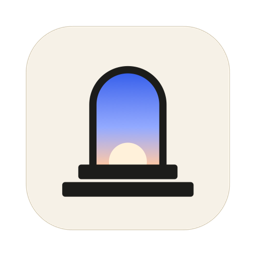
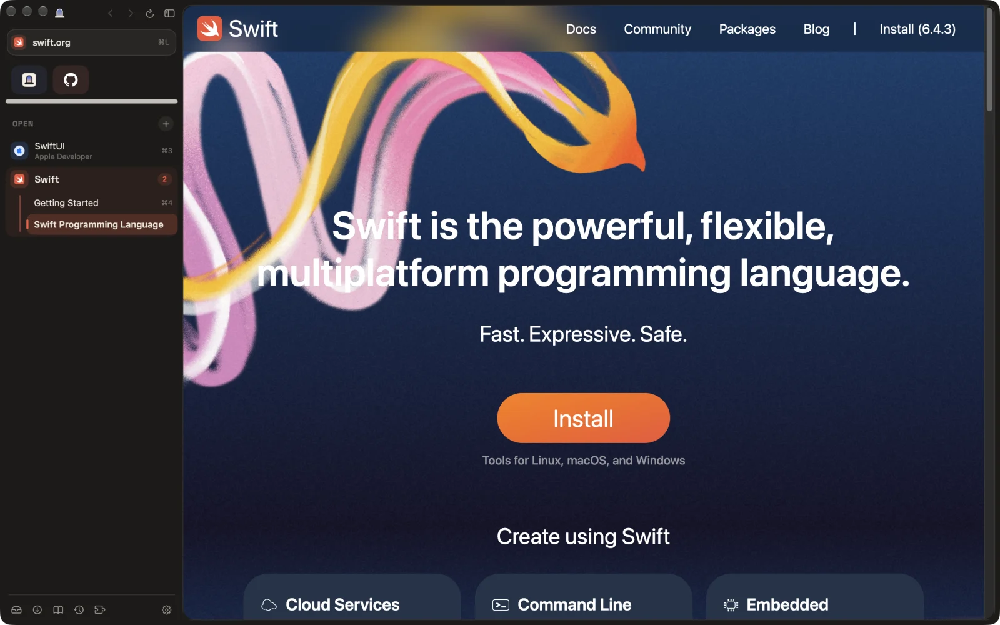
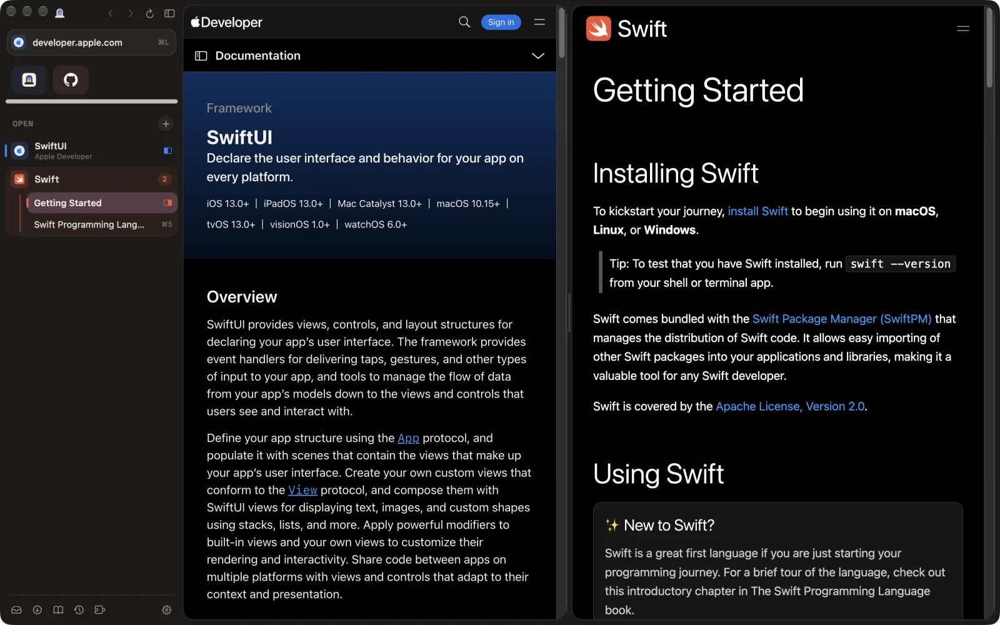
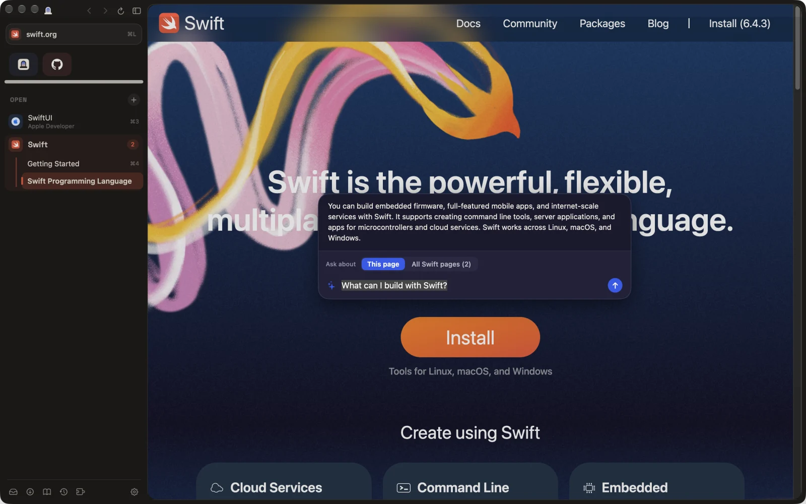
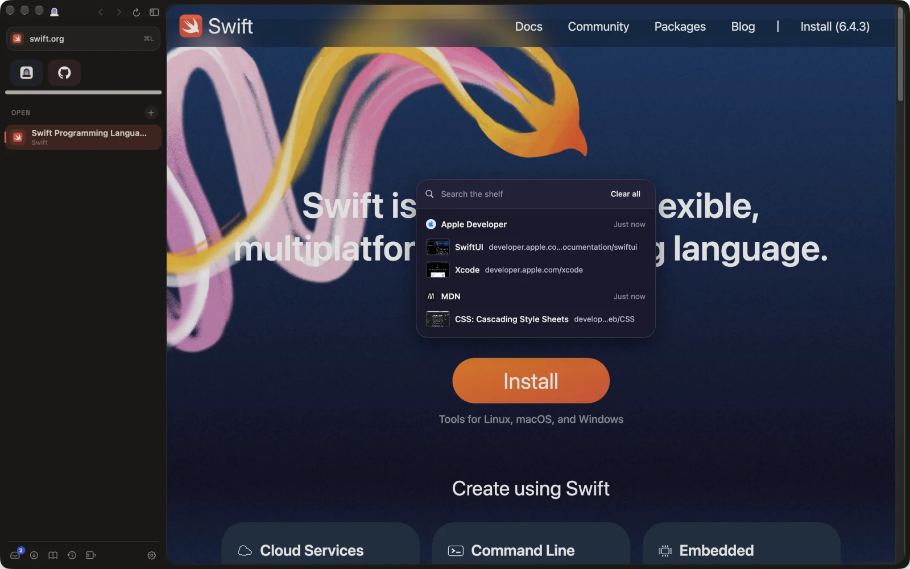

<p align="center">
  
</p>

<h1 align="center">Plinth Chromium</h1>

<p align="center">
  <b>A calm, native macOS browser on Chromium, with Chrome extensions.</b><br>
  Pages grouped by website, sites that fade onto a shelf, and on-device AI, in a dock or a sidebar.
</p>

<p align="center">
  <a href="https://github.com/brandonzalcman/plinth-chromium-releases/releases/latest"></a>
  
  
  <a href="LICENSE"></a>
  <a href="https://getplinth.dev"></a>
</p>

<p align="center">
  <a href="https://github.com/brandonzalcman/plinth-chromium-releases/releases/latest"><b>Download</b></a> ·
  <a href="https://getplinth.dev">Website</a> ·
  <a href="#build-and-run">Build from source</a> ·
  <a href="CONTRIBUTING.md">Contribute</a> ·
  <a href="https://github.com/brandonzalcman/Plinth">Plinth for WebKit</a>
</p>

<p align="center">
  
</p>

Plinth Chromium is [Plinth](https://github.com/brandonzalcman/Plinth) on Chromium's engine. Pages are named and grouped by website, sites you stop using fade onto a shelf, and there are pins, pin folders, groups and split view. It adds Chrome extensions, which the WebKit version of Plinth can't run.

## Download

**[Get the latest release](https://github.com/brandonzalcman/plinth-chromium-releases/releases/latest)**. Open the disk image and drag Plinth Chromium to Applications. It's signed and notarized by Apple and updates itself. You can also choose **Plinth → Check for Updates**.

It needs macOS 26 on an Apple silicon Mac. Past versions and release notes are on the [releases page](https://github.com/brandonzalcman/plinth-chromium-releases/releases).

## What it does

### Your pages, in a dock or a sidebar


The dock is the Mac app's bar. The sidebar puts the address field at eye level, pins on a slab and sites as cards, and collapses to a rail that flies out on hover. Pages are named and grouped by website, and the ones you leave fade gradually. Switch layouts in **Settings → Pages**.

### Split view



Drag a page onto another to split, drag the divider to resize them, and double-click it to even them out.

### Ask about the page



Press ⌘J to ask a question about this page, all of a site's pages, or both sides of a split. Apple's on-device model answers, so nothing leaves the Mac. The same model powers history search by meaning and the "where you left off" card when a site comes back.

### The shelf



Sites you stop using are put away on the shelf, with a snapshot of each page, so the bar stays short. Search the shelf, bring a site back, or clear it (and undo that for a few seconds).

### And more

- **Chrome extensions** run as they do in Chrome, with their buttons in Plinth's toolbar.
- **Pins and pin folders**: drag pins together to make a folder, shown as an icon or as a list.
- **Groups**: Plinth notices sites you use together and offers to group them.
- **Import** bookmarks, history and passwords from Safari, Chrome, Firefox and other browsers on the Mac.
- **Privacy settings**: always use HTTPS, block third-party cookies, and send Global Privacy Control.
- **Peek** (⇧-click a link), a mini window for links from other apps, Points & Levels, and a welcome guide.

Not done yet: iCloud sync in released builds, a content blocker of its own (an extension works), and a few extension features. [docs/architecture.md](docs/architecture.md) lists them all.

## How it's built

It's a Swift and AppKit app. It embeds Chromium through the [Chromium Embedded Framework](https://github.com/chromiumembedded/cef) (CEF), in Chrome style so extensions work, behind a small Objective-C++ bridge. Plinth's behaviour for pages (naming, pins, folders, groups, fading, the shelf, sync and the AI features) comes from the public [Plinth](https://github.com/brandonzalcman/Plinth) package's `PlinthCore` and `PlinthMacUI` products. This repo adds the Chromium layer and the shell around it.

| Target | What it is |
| --- | --- |
| `CEFWrapper` | CEF's C++ wrapper library, compiled from `Vendor/cef/libcef_dll` |
| `PlinthCEF` | The Objective-C++ bridge: the runtime, profiles, and Chrome-style browsers in their own windows |
| `PlinthChromiumHelper` | The helper executable for Chromium's GPU, renderer, utility and plugin processes |
| `PlinthSidebar` | Pure logic for the sidebar (its model, the rail, and intents that become bar actions) |
| `PlinthExtensions` | Reads installed extensions and their popups from the Chromium profile |
| `PlinthBrowserImport` | Bookmark, history and password import from other browsers, and password CSVs |
| `PlinthChromiumApp` | The app shell: store and pages, windows, dock and sidebar, panels, menus, settings |
| `PlinthChromium` | The executable, plus Sparkle for updates |

[docs/architecture.md](docs/architecture.md) explains how pages are shown and why, and [docs/icloud-sync.md](docs/icloud-sync.md) covers iCloud sync, which needs a build signed with an iCloud provisioning profile.

## Build and run

You need macOS 26 and Xcode 26 (Swift 6.2). If `swift` can't find the macOS SDK, set `DEVELOPER_DIR=/Applications/Xcode.app/Contents/Developer`.

Download CEF once. This is about 140 MB, into `Vendor/cef`, and the download is checked against CEF's published checksum:

```bash
Scripts/fetch-cef.sh
```

Build the app. This makes `build/Plinth Chromium.app`, signed to run on your Mac only, with no iCloud and no updates:

```bash
Scripts/bundle.sh
```

Run it on a throwaway profile, so your own browsing data is never touched:

```bash
PLINTH_STORAGE=/tmp/plinth-chromium-dev "build/Plinth Chromium.app/Contents/MacOS/Plinth Chromium"
```

Run the tests. They cover the shared logic and don't need a running browser:

```bash
swift test
```

### Development switches

| Variable | Effect |
| --- | --- |
| `PLINTH_STORAGE=<dir>` | Use a throwaway profile in that folder (and never ask the Keychain) |
| `PLINTH_OPEN=<urls>` | Open these pages, comma-separated |
| `PLINTH_LAYOUT=dock\|sidebar` | Start in that layout |
| `PLINTH_LOAD_EXTENSION=<folder>` | Load an unpacked extension (try `Tests/Fixtures/test-extension`) |
| `PLINTH_IMPORT_HOME=<folder>` | Point import at fixture browser data |
| `PLINTH_SYNC=memory` | Sync with an in-memory server instead of iCloud |
| `PLINTH_WELCOME=0` | Skip the welcome guide |
| `PLINTH_CEF_LOG=1` | Log CEF's lifecycle |
| `PLINTH_STEPS="wait 3; open https://example.com; state; quit"` | Run scripted steps, logged as `[steps]` lines (see `Sources/PlinthChromiumApp/DebugSteps.swift`) |

`swift Scripts/dev/shoot.swift <pid> <out.png>` captures only that app's windows, for screenshots of a test run.

## Contributing

Bug reports, fixes and ideas are welcome. See [CONTRIBUTING.md](CONTRIBUTING.md). For security problems, see [SECURITY.md](SECURITY.md) and please don't open a public issue.

## Releasing

Maintainers build releases with `Scripts/release.sh <version>`. It makes a Developer ID signed, notarized disk image and a signed [Sparkle](https://sparkle-project.org) update feed in `build/release/`. Both are published in [plinth-chromium-releases](https://github.com/brandonzalcman/plinth-chromium-releases) as release `v<version>`, with notes from `release-notes/<version>.md`. The script needs a Developer ID certificate, a notary profile (`xcrun notarytool store-credentials plinth-notary`) and the Sparkle signing key in the login keychain. None of these are in this repository.

## License

Plinth Chromium is free software under the [GNU General Public License v3](LICENSE), like Plinth. It includes or downloads third-party software under its own licences: Chromium and CEF, Sparkle, and the Space Grotesk font. See [THIRD_PARTY_NOTICES.md](THIRD_PARTY_NOTICES.md).

"Plinth" and the Plinth mark are the project's name and logo. If you ship your own build, please give it a different name and icon.
